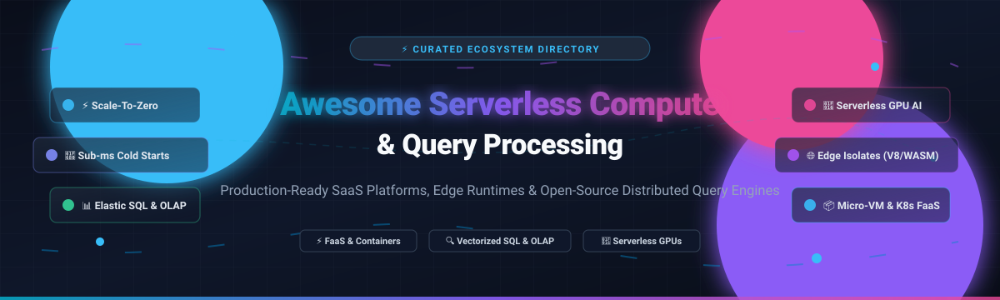

  

# ⚡ Awesome Serverless Compute & Query Processing 🚀

### A Curated Directory of Serverless Architecture, Elastic Query Engines, FaaS & Edge Computing Runtimes

  
  
  
  
  
  

  <b>Explore state-of-the-art serverless computing, vectorized SQL query processing engines, event-driven functions (FaaS), and scale-to-zero container platforms.</b>

---

## 📑 Table of Contents

- [🌐 Sector Overview & Market Dynamics](#-sector-overview--market-dynamics)
- [☁️ SaaS / Managed Cloud Platforms](#️-saas--managed-cloud-platforms)
- [🛠️ Open-Source GitHub Projects](#️-open-source-github-projects)
- [🏛️ Architectural Deep Dive](#️-architectural-deep-dive)
  - [🔍 Serverless Query Engines & Elastic OLAP](#-serverless-query-engines--elastic-olap)
  - [⚡ Event-Driven FaaS & Edge Micro-VMs](#-event-driven-faas--edge-micro-vms)
  - [🤖 Serverless GPU AI Inference](#-serverless-gpu-ai-inference)
- [📈 Star History](#-star-history)
- [🤝 How to Contribute](#-how-to-contribute)
- [💖 Support & Sponsorship](#-support--sponsorship)
- [⚖️ Disclaimer & License](#️-disclaimer--license)

---

## 🌐 Sector Overview & Market Dynamics

- 📊 **Market Size**: The global serverless architecture and compute market is estimated at **$20.8 billion in 2024–2025** and is projected to expand beyond **$65 billion to $90+ billion by 2030–2032**, recording a compound annual growth rate (**CAGR of ~22–25%**). Parallelly, the cloud data warehouse and elastic query processing sector accounts for over **$10+ billion** in enterprise spend, fueled by real-time streaming analytics and generative AI inference workloads.
- 🔄 **Market Dynamics**: The industry exhibits a **moderately concentrated, bifurcated structure**. Primary cloud hyperscalers (AWS Lambda, Google Cloud Run, Azure Functions) alongside established analytical cloud data platforms (Snowflake, Databricks) command the dominant volume of enterprise IT budgets. In parallel, aggressive innovation drives rapid adoption for specialized independent platforms pioneering edge V8 isolates (Cloudflare Workers), developer Postgres branching (Neon, Supabase), and serverless GPU execution (Modal).

---

## ☁️ SaaS / Managed Cloud Platforms

| 🏢 Platform | 💰 Valuation / Revenue | 🏷️ Pricing (Starting Tier) | 🎁 Free Tier Limit | 🌟 Highlights / Capabilities |
| :--- | :--- | :--- | :--- | :--- |
| **[Google Cloud Run](https://cloud.google.com/run)** | ~$3.05 Trillion MCap (Alphabet) / Google Cloud ~$43.7B ARR | Pay-as-you-go: CPU at $0.00002400/vCPU-sec, Memory at $0.00000250/GiB-sec, Requests at $0.40/million | **Free Forever**: 2,000,000 requests/month, 360,000 vCPU-seconds, 180,000 GiB-seconds, plus 1 GiB outbound egress/month. $300 credits for 90-day trial for new accounts. | Fully managed container platform that autoscales containers from 0 to thousands; runs any containerized HTTP microservice without cluster ops. |
| **[Azure Functions](https://azure.microsoft.com/en-us/products/functions)** | ~$3.02 Trillion MCap (Microsoft) / Microsoft Intelligent Cloud ~$105B+ Revenue | Consumption plan: $0.20 per million executions + $0.000016/GB-sec execution time | **Free Forever**: 1,000,000 executions and 400,000 GB-seconds resource consumption every month. $200 credits for 30-day trial for new accounts. | Enterprise event-driven serverless platform with native declarative triggers across cloud services; supports C#, Python, JS/TS, Java, and PowerShell. |
| **[AWS Lambda](https://aws.amazon.com/lambda/)** | ~$2.05 Trillion MCap (Amazon) / AWS ~$105B+ Revenue | Pay-as-you-go: $0.20 per 1 million requests + $0.0000166667 per GB-second (x86) / $0.0000133334 per GB-second (Arm/Graviton2) | **Free Forever**: 1,000,000 free requests and 3,200,000 seconds of compute time (up to 400,000 GB-seconds) every month. | The industry pioneer in FaaS; automatically triggers stateless functions upon event ingestion with millisecond metering. |
| **[Databricks Serverless](https://www.databricks.com/)** | $43 Billion Valuation (Private) / ~$2.6 Billion ARR | Serverless compute billed per Databricks Unit (DBU): starting at ~$0.07–$0.22/DBU-hour (e.g. ~$0.70/hour for Small Serverless SQL warehouse) | **Free Trial**: 14-day free trial with full platform access and usage credits (underlying cloud infrastructure costs may apply). | Serverless compute runtime for Lakehouse notebooks, DAG workflows, and interactive SQL queries with zero cluster administration. |
| **[Snowflake Serverless Warehouses](https://www.snowflake.com/)** | ~$48 Billion MCap (NYSE: SNOW) / ~$3.6 Billion ARR | Credit-based consumption: Standard Edition at ~$2.00 to ~$3.00 per compute credit (1 credit/hour for X-Small serverless warehouse) | **Free Trial**: 30-day free trial with $400 worth of free platform credits (no upfront credit card required). | Elastic multi-cluster SQL analytics and Snowpark compute engine; dynamically scales compute resources with per-second billing. |
| **[Cloudflare Workers](https://workers.cloudflare.com/)** | ~$35 Billion MCap (NYSE: NET) / ~$1.7 Billion ARR | Paid Workers plan starts at $5/month (includes 10M requests/month + $0.30/million additional requests, CPU time at $0.02/million CPU-milliseconds) | **Free Forever**: 100,000 requests per day, up to 10ms CPU execution time per request, across 300+ global edge datacenters. | Edge serverless execution using V8 isolates; provides 0ms cold starts with integrated distributed storage (KV, R2, D1, Vectorize). |
| **[Supabase Functions](https://supabase.com/docs/guides/functions)** | ~$5 Billion Valuation (Private) / ~$40 Million ARR | Pro plan starts at $25/month (includes 2,000,000 invocations/month, additional invocations at $2 per 1M) | **Free Forever**: 500,000 function invocations per month, 100 concurrent executions, and 500MB database storage. | Edge Functions executing TypeScript on Deno; deeply integrated with Postgres database tables, real-time websockets, and row-level security. |
| **[Neon Serverless Postgres](https://neon.tech/)** | ~$1.0 Billion Valuation (Private) / ~$15 Million ARR | Launch plan starts at $19/month (includes autoscaling up to 4 CU, 10 GB storage; additional compute at $0.16/CU-hour, storage at $0.15/GB-month) | **Free Forever**: 0.5 Compute Units (CU) with scale-to-zero after 5 min of idle time, 0.5 GB storage, and up to 10 database branches. | Decouples PostgreSQL storage and compute; delivers instant point-in-time copy-on-write branching and scale-to-zero capabilities. |
| **[Modal](https://modal.com/)** | ~$700 Million Valuation (Private) / ~$10 Million ARR | Pay-per-second usage: CPU starting at $0.000023/core-second (~$0.0828/core-hr), RAM at $0.0000023/GiB-sec; GPUs starting at ~$0.59/hr (T4) to ~$4.50/hr (A100) | **Free Forever**: $30 of free compute credits renewed every month for personal accounts (~50 hours of CPU or ~35 hours of GPU compute). | Developer-first serverless compute runtime designed for Python and generative AI; deploys GPU containers in seconds with container-in-code abstraction. |
| **[Momento](https://www.gomomento.com/)** | ~$100 Million Valuation (Private) / Seed/Series A Funded (~$15M Raised) | Pay-as-you-go: $0.15 per GB of data transferred in/out for Momento Cache and Topics; zero cluster or provisioned capacity charges | **Free Forever**: 50 GB per month of data transfer completely free across Cache and Topics forever with no expiration date. | Serverless distributed caching and real-time pub/sub messaging engine designed for microsecond data retrieval from serverless Lambdas. |

---

## 🛠️ Open-Source GitHub Projects

All open-source tools below are equipped with live stargazers badges linking directly to their GitHub stargazers page, ordered by GitHub star count (descending).

| 📦 Project | ⭐ Stars | 📋 Category / Architecture Overview | 📜 License |
| :--- | :--- | :--- | :--- |
| **[vLLM](https://github.com/vllm-project/vllm)**  | ~95.9k | High-throughput, memory-efficient serverless LLM serving engine featuring PagedAttention and dynamic continuous batching. | Apache-2.0 |
| **[DuckDB](https://github.com/duckdb/duckdb)**  | ~42.7k | High-performance in-process vectorized analytical SQL query engine; the standard for embedded serverless and WebAssembly OLAP. | MIT |
| **[OpenFaaS](https://github.com/openfaas/faas)**  | ~26.3k | Kubernetes-native serverless functions platform for event-driven microservices with scale-to-zero autoscaling, metrics, and CLI. | Apache-2.0 (CE) |
| **[Neon](https://github.com/neondatabase/neon)**  | ~23.3k | Open-source serverless PostgreSQL storage engine separating compute and storage with copy-on-write branching and scale-to-zero. | Apache-2.0 |
| **[Trino](https://github.com/trinodb/trino)**  | ~13.4k | Fast distributed SQL query engine for elastic federated queries across object stores (S3, GCS), data lakes, and transactional databases. | Apache-2.0 |
| **[KEDA](https://github.com/kedacore/keda)**  | ~10.7k | Kubernetes-based Event Driven Autoscaling engine driving scale-to-zero and burst container scaling from 60+ event sources. | Apache-2.0 |
| **[Apache DataFusion](https://github.com/apache/datafusion)**  | ~9.6k | Embeddable, in-memory vectorized SQL query engine written in Rust and powered by the Apache Arrow memory format. | Apache-2.0 |
| **[workerd](https://github.com/cloudflare/workerd)**  | ~9.1k | The high-performance JavaScript / Wasm serverless runtime powered by Google V8 that drives Cloudflare Workers. | Apache-2.0 |
| **[Fission](https://github.com/fission/fission)**  | ~8.9k | Fast, developer-friendly serverless framework for Kubernetes featuring sub-100ms cold starts through warm container pools. | Apache-2.0 |
| **[Apache OpenWhisk](https://github.com/apache/openwhisk)**  | ~6.8k | Distributed, Apache-governed serverless computing platform executing code in response to events with rich rule/trigger bindings. | Apache-2.0 |
| **[Knative Serving](https://github.com/knative/serving)**  | ~6.1k | Kubernetes-native building block for deploying serverless workloads with request-driven autoscaling down to zero. | Apache-2.0 |
| **[Nuclio](https://github.com/nuclio/nuclio)**  | ~5.8k | Extreme-performance serverless event processor handling hundreds of thousands of operations/sec; optimized for data and GPU compute. | Apache-2.0 |
| **[Beam (beta9)](https://github.com/beam-cloud/beta9)**  | ~1.8k | Self-hostable serverless GPU runtime and sandbox platform with fast image builds, memory snapshotting, and GPU checkpoint/restore. | Apache-2.0 |
| **[OpenLambda](https://github.com/open-lambda/open-lambda)**  | ~1.0k | Research serverless platform exploring container virtualization, package caching, and zero-overhead microservice invocations. | Apache-2.0 |
| **[OpenRun](https://github.com/openrundev/openrun)**  | ~992 | Declarative GitOps deployment platform and self-hostable Google Cloud Run alternative supporting scale-to-zero container apps. | Apache-2.0 |
| **[ramune](https://github.com/i2y/ramune)**  | ~8 | Go runtime with soundness-gated native AOT compilation for running Cloudflare Workers handlers as single standalone binaries. | MIT |
| **[fn0](https://github.com/namseent/fn0)**  | ~6 | Lightweight V8 and Wasmtime-based serverless FaaS with transactional document store, WASI 0.3 support, and OpenTelemetry. | Apache-2.0 |
| **[Self-Hosted Serverless](https://github.com/mstgnz/self-hosted-serverless)**  | ~2 | Minimalist Go and WASI-compatible self-hostable FaaS alternative to AWS Lambda with gRPC, Redis, and Postgres integration. | MIT |

---

## 🏛️ Architectural Deep Dive

### 🔍 Serverless Query Engines & Elastic OLAP
- **Vectorized In-Process Engines**: **DuckDB** and **Apache DataFusion** allow embedded analytical SQL execution inside edge functions, lambdas, and browser sandboxes without managing external database server clusters.
- **Distributed Query Federation**: **Trino** serves as the backbone for querying exabytes of data across heterogeneous data sources with high concurrency and decoupled storage/compute.
- **Decoupled Postgres Compute**: **Neon** implements a multi-tenant storage engine with copy-on-write branching, enabling serverless applications to spin up read/write isolated database instances in seconds.

### ⚡ Event-Driven FaaS & Edge Micro-VMs
- **Kubernetes Autoscaling Foundation**: **Knative Serving** and **KEDA** supply the standardized primitives for scaling arbitrary containers from zero to tens of thousands of instances based on HTTP requests, event queues, and custom metrics.
- **Micro-VM & Edge Execution**: **workerd** provides the V8-isolate foundation for edge compute with sub-millisecond overhead, while **Beam** brings checkpoint-restore mechanisms to serverless GPU infrastructure.

### 🤖 Serverless GPU AI Inference
- **PagedAttention & Continuous Batching**: **vLLM** has reshaped serverless generative AI hosting by treating KV cache memory like virtual memory pages, cutting memory fragmentation to under 4% and drastically driving down per-token compute costs.

---

## 📈 Star History

---

## 🤝 How to Contribute

Contributions are wholeheartedly welcome! Here is how you can help keep this repository the premier curated resource on serverless compute and query engines:

1. 🍴 **Fork the repo** to your own GitHub account.
2. 🌿 **Create a new branch** (`git checkout -b feature/add-new-serverless-tool`).
3. 📝 **Add or update entries in `README.md`** following the established table structure:
   - Provide exact pricing, verified free-tier limits, and factual architectural notes.
   - For open-source repositories, include the official stargazer badge and repository link.
4. 🚀 **Submit a Pull Request** with a concise description of why the tool belongs in this curated list.

---

## 💖 Support & Sponsorship

If this curated guide has saved you architecture research time or helped your infrastructure planning, please consider showing your support:

- ⭐ **Star this repository** to help others discover it across GitHub.
- 🍴 **Fork and share** with fellow DevOps, Data, and Platform engineers.
- ☕ **Buy a coffee or sponsor ongoing maintenance**: Support directly via the [GitHub Sponsors Dashboard](https://github.com/sponsors/ishandutta2007).

Your sponsorship directly powers independent open-source research and continuous curation!

---

## ⚖️ Disclaimer & License

- 📖 This repository is a **community-curated index** created for educational and informational purposes; it does not constitute commercial endorsement.
- 🛡️ **Security Notice**: Running untrusted code on serverless platforms requires defense-in-depth isolation (e.g. gVisor, Firecracker micro-VMs, or hardened V8 isolates).
- 📄 Content and curation are licensed under the [MIT License](https://github.com/ishandutta2007/Awesome-Serverless-Compute-Query-Processing/blob/main/LICENSE).

---

  <b>Built with ❤️ for platform engineers, cloud architects, and data infrastructure teams worldwide.</b>

